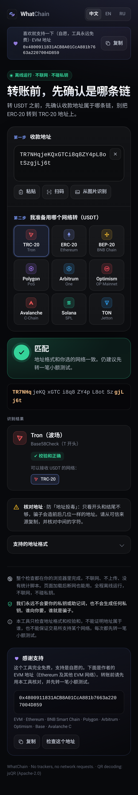
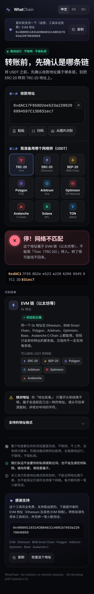

# WhatChain

**转账前先查：这个地址是哪条链的？ · Check which chain an address is on before you send · Проверьте сеть адреса перед переводом**

👉 **[打开 WhatChain / Open / Открыть](https://whatchain.akonbek19.workers.dev)**

<p>


</p>

## 中文
很多人把 USDT 转错网络（比如把 ERC-20 转到 TRC-20 地址），钱就很难找回。WhatChain 帮你在转账前确认：
- 粘贴地址或上传二维码截图，自动识别属于哪条链，并校验地址是否抄错；
- 选择你准备用的网络，页面直接告诉你 ✅ 匹配、⚠️ 需要确认，还是 ⛔ 停下；
- 支持 EVM（以太坊、BSC、Polygon、Arbitrum、Optimism、Base、Avalanche）、TRON、比特币、Solana、TON、莱特币、狗狗币、XRP；
- 全程在浏览器里离线运行，不联网，不碰私钥，永远不会问你要助记词。

只检查地址格式，不检查地址归属。大额转账前请先小额测试。

## English
Paste an address (or a QR screenshot), pick the network you plan to use, and WhatChain tells you whether they match — fully offline, in your browser, never touching private keys. Checks format only, not ownership; always send a small test first.

## Русский
Вставьте адрес (или скриншот QR), выберите сеть — WhatChain покажет, совпадают ли они. Работает полностью офлайн в браузере и никогда не запрашивает приватные ключи. Проверяется только формат адреса; перед крупным переводом отправьте небольшую тестовую сумму.

## 支持 · Support · Поддержать
工具永远免费，支持完全自愿。EVM 地址（以太坊及其他 EVM 网络）：

```
0x4800911831ACB8A01CcA881b7663a2207004D859
```
